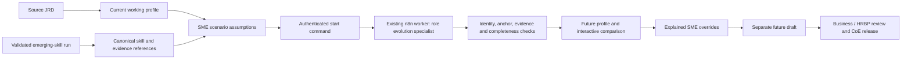

# AI skills and emerging role scenarios

## Product decisions

The existing pilot is extended in place. The fourteen previously identified test cases were already archived when checked on 26 November 2026. They remain recoverable; the global source library is retained.

The working interpretation of “AI Skills” is a topical catalogue lens, alongside one primary Technical, Functional or Behavioural source category. Explicit AI terminology in a source name supplies a suggested topical match, not an approved new definition. The Owner can review this annotation. A general capability appears under contextual AI skills only after an explicit application boundary and rationale. An optional single secondary category is an explained exception. No duplicates or automatic cross-tagging of all behavioural skills are introduced. Source records and identities stay immutable.

AI profile integration uses existing source JRDs, canonical concepts and completed emerging-skill research. External AI profile material can later supply role tasks and evidence through intake; it must map to canonical IDs, retain provenance and respect each skill's own anchors. No external profile library or unverified template has been invented or imported in this release.

## Role evolution

The new section compares the saved working profile with a separate future-profile draft. Existing proposed role extensions are explicitly distinguished from approved source-JRD facts. It requires a mapped JRD with 1–20 requirements and a completed research run with at least five distinct evidenced skills. Manually labelling observations as source-supported cannot satisfy that gate.

The SME sets adoption, task automation and process transformation assumptions from 0–100%, plus a horizon. Defaults are starting assumptions, not benchmarks or staffing forecasts. The specialist reasons about their task implications. Moving these assumption sliders marks the last analysis as a different scenario and blocks its application until reanalysis. There is no invented numeric formula translating adoption percentages into proficiency.

Per-skill sliders immediately update the spider chart and comparison. Future target levels use that skill's own 1–4 anchors; clearing a target means unknown, not level zero. Relevance has a separate qualitative 1–5 scale. Unknown chart points are omitted; polygon area is not a score. The first eight axes are shown and every capability remains available below. A manual target, relevance or demand-status override needs an SME rationale of at least twelve characters.

The agent preserves every current requirement exactly once, adds only supported canonical concepts, links changed tasks/targets to matching signal IDs, and leaves uncovered new concepts as catalogue candidates. The validator rejects omitted requirements, cross-skill evidence, invented identities, unavailable anchors and stale source versions. Declining demand is not an employee assessment or a recommendation to remove a person.

Applying creates `case.evolution`, including the scenario, source-profile hash, evidence, changes and manual overrides, with a history snapshot and a new case version. It does not replace `case.requirements`, individual or organisational baselines, or the source JRD. Business/HRBP validation and CoE release remain separate.

## n8n interaction audit and implementation

`scripts/audit-sbo-workflows.mjs` inspects only the owned Studio workflows and writes a local, credential-free interaction report. The deployed architecture uses `Execute Workflow` / `Execute Workflow Trigger` for explicit dispatch and the bounded gateway worker for specialist prompts. It does not currently use an n8n AI Agent root or `Call n8n Workflow Tool`.

The [official Workflow Tool documentation](https://docs.n8n.io/integrations/builtin/cluster-nodes/sub-nodes/n8n-nodes-langchain.toolworkflow/) defines that node as a tool an AI agent selects to call another workflow and obtain its output. [n8n's production architecture guidance](https://blog.n8n.io/production-ai-playbook-complex-agent-patterns/) recommends separating deterministic operations, simple model calls and genuine agent reasoning. The Studio's fixed profile → research → scenario → review path is retained as explicit routing; adding a dynamic model-selected delegation loop would change the architecture and latency without being necessary for this path.

Role evolution is the sixth specialist function on the same run contract, identity boundary, model gateway, lease, validation, idempotency and completion-CAS mechanism. Its operation is `sbo.profile.evolve.start`; explicit future-profile application uses `sbo.profile.evolution.apply`. Topic annotation uses Owner-only `sbo.skill.classify`. Raw input snapshots stay private. The route has a 75-second model ceiling, one transient fallback and low reasoning on the primary model; it does not retrieve arbitrary URLs or recursively call agents.

If dynamic delegation becomes a requirement, extract independently reusable analysis subworkflows with explicit case/version/run inputs, structured outputs and published private workflow references, then expose the relevant read/analysis functions through `Call n8n Workflow Tool`. Keep writes and approvals behind authenticated, confirmed commands. Tool subnodes resolve expressions against their first input item; multi-case batches must be split or explicitly enveloped rather than accidentally mixing case contexts. No such unused tool or unverified extra orchestration loop is deployed here.

## Verification

Tests cover source-preserving topical annotations, contextual and overlap boundaries, complete research prerequisites, immutable input snapshots, worker routing, complete base-profile coverage, evidence/anchor rejection, explained overrides, stale scenarios, separate future-profile persistence, and preservation of manual edits after saving. Live acceptance additionally checks the actual gateway scenario response, interactive chart controls and unchanged source/profile baselines.
