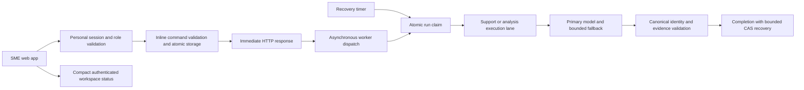

# Skill Design Studio Hardening

23 November 2026. The platform must preserve SME drafts and distinguish unavailable infrastructure from invalid model output. Long analyses run asynchronously; the browser exchanges compact workspace state after its initial catalogue load. All model calls stay on the existing authorised Eraneos gateway.

## Findings and decisions

The failed AI Consultant walkthrough exposed intermittent n8n HTTP 503 responses, timeouts and a failed model request. The original worker reduced provider failures to a generic gateway error, so the historical upstream cause cannot be determined retrospectively. Fresh small probes returned HTTP 200 for Sonnet, GPT Luna and Haiku in 0.4–1.1 seconds. A full canonical mapping prompt of about 84,000 characters returned a validated draft through GPT Luna in 16 seconds. These measurements establish current connectivity, not an availability SLA.

The browser previously fetched a complete workspace for status updates, including catalogue data, history and run input snapshots. The private workspace operation also required a nested n8n execution. Slow responses could overlap and stale state could remain visible. Compact responses, inline command execution after authentication, sequential polling with backoff and explicit connection notices address these application costs. They do not establish the cause of the platform HTTP 503 incidents.

## Request and execution architecture

Personal membership, source immutability, separate JRD approval and the disabled formal publisher remain enforced. The shared public access endpoint remains retired. The dispatch trigger is callable by workflows with the same owner, after the HTTP response; the minute timer recovers a missed dispatch. One support run and one analysis run may execute concurrently. Duplicate work within the same case and lane is rejected, and atomic claims prevent duplicate model calls from competing triggers.

## Model routing and recovery

| Function | Primary | Fallback | Output limit |
| --- | --- | --- | --- |
| Role mapping | GPT 6 Luna | Claude Sonnet 5 | 6,000 tokens |
| Trends and emerging skills | Claude Sonnet 5 | GPT 6 Luna | 6,000 tokens |
| Upskilling formats | GPT 6 Luna | Claude Sonnet 5 | 5,000 tokens |
| Contextual support | GPT 6 Luna | Claude Sonnet 5 | 1,800 tokens |

Haiku was excluded from production routing after live support and upskilling probes returned non-JSON commentary despite JSON-only instructions and a JSON response-format request. Validators rejected these outputs without adopting them. Routing eligibility therefore depends on the full output contract, not a successful connectivity probe.

Each provider attempt has a 45-second timeout. A transient server or connection failure permits one fallback attempt. Authentication errors, malformed requests, truncated output and canonical/evidence validation failures do not trigger a provider retry. A rate limit with an explicit Retry-After instruction stops automatic fallback. This avoids silently stacking retries across the UI, n8n and model SDK.

HTTP Request nodes replace the LangChain model wrapper so provider status, finish reason and output can be classified at the gateway boundary. Diagnostics contain the selected model, attempt count, elapsed model time and a safe error code. They exclude raw provider errors, headers, prompts and credentials. Completion conflicts re-read storage and reapply the same validated result up to three times; they do not repeat the model call. A remaining conflict or expired lease requires explicit recovery and never creates a synthetic success.

## Agent handoff integrity

Trend retrieval always includes the canonical skills already present in the input role profile, alongside newly retrieved candidates. The linked case regression exposed a failure when retrieval pruning excluded existing profile skills even though they remained in the model context. Those IDs now remain explicitly eligible; canonical identity and source validation stay strict.

Upskilling receives the responsible SME explicitly in its context. Text fields have explicit types; a bounded list of prerequisite strings is joined into the single text field required by the app. Objects and invalid references remain rejected. This resolves the linked-case failure that occurred when multiple prerequisites were returned as an array.

## Data and frontend performance

The initial authenticated load supplies the immutable catalogue and global JRDs. Later status responses and compact command receipts reuse those records from memory, scoped to the current access token. No internal workspace is added to browser persistent storage. Public responses omit history, idempotency receipts and run input snapshots. A response with an earlier workspace revision cannot roll the client back.

On the captured pilot snapshot, storage JSON was 2,228,908 bytes, the projected initial response 2,153,390 bytes, and the compact status response 78,898 bytes: 96.5 percent less than the previously transferred storage representation. Status size grows with cases and results; separating large result storage from operational state is the next scaling step if that growth becomes material.

The UI permits one background request at a time, pauses while hidden or processing a command, and backs off after failures. Connection retries preserve the same request body, expected revision and idempotency identifier. A changed workspace revision can be retried against fresh state only when the target case version is unchanged. A failed SME contribution remains editable in its drawer. Temporary service failures preserve the personal sign-in; expired or rejected sessions require reauthentication.

Earlier-version results are collapsed and carry a source-role label when that metadata exists. Operational diagnostics are visible beside the run. Business SMEs and HR BPs validate proposals; CoE grants final release through a separately governed publisher.

## Research availability

Live research uses selected allowlisted URLs. When retrieval fails, the worker may use a matching cached reference retrieved within the preceding 30 days. It rejects unknown URLs, future timestamps and expired entries, and prefers live evidence. Cache entries contain source text, retrieval timestamp and a SHA-256 fingerprint from an actual successful retrieval. Run `node scripts/refresh-sbo-source-cache.mjs` to refresh this protected cache. Cache use and reduced coverage are exposed in results; cached guidance is not labelled as a newly published trend.

The initial refresh retrieved DEKRA AI services and the WEF report. NIST, OECD and Cedefop were unavailable during that refresh; this remains a source-coverage limitation.

## Acceptance and operational limits

Automated acceptance covers compact projection, cache merge ordering, provider timeout/error classification, Retry-After handling, truncation, telemetry redaction, generated workflow graph integrity and existing governance/identity/CAS rules. Live acceptance must exercise the real authenticated API, immediate dispatch, model routing, source-bound results and the AI Consultant case. Proposals still require semantic SME validation.

Do not change shared n8n infrastructure settings as part of this release. For sustained multi-user load, measure main-process and database pressure before introducing Redis-backed queue mode, dedicated workers, webhook processors or a production concurrency limit. A global limit can also delay webhook acknowledgements; isolated application backpressure is not a substitute for capacity planning. [n8n concurrency control](https://docs.n8n.io/hosting/scaling/concurrency-control/), [n8n queue mode](https://docs.n8n.io/hosting/scaling/queue-mode/).

Gateway error classification and retry policy follow the separation of connection, rate-limit and status errors in the [OpenAI SDK](https://github.com/openai/openai-node#retries) while keeping retries explicit at one application boundary. n8n HTTP Request does not automatically honour Retry-After; the workflow must make that decision. [n8n rate limits](https://docs.n8n.io/integrations/builtin/rate-limits/).

## Live acceptance results

All four specialist functions succeeded in labelled technical n8n cases. Role mapping returned two requirements; trends returned one source-bound signal after a real fallback from Sonnet to GPT Luna; upskilling returned four measures; support returned a contextual response. Observed model time was approximately 1 second for mapping, 60 seconds for the two-attempt trend run, 22 seconds for upskilling and 9 seconds for support. Complete queue-plus-processing time was respectively 37, 107, 192 and 17 seconds during the four-job batch. These are sample observations, not an SLA.

All 44 automated tests and the deployed frontend build passed. The browser test saved a synthetic assessment with partial coverage while proficiency remained unknown. Forged session/role and untrusted-origin requests returned 401/403 without workspace data. Temporary acceptance drivers are inactive. The protected human-session walkthrough was not repeated because no new OTP was submitted. `HARDENING_ACCEPTANCE.json` records the measurements without business data or credentials.
